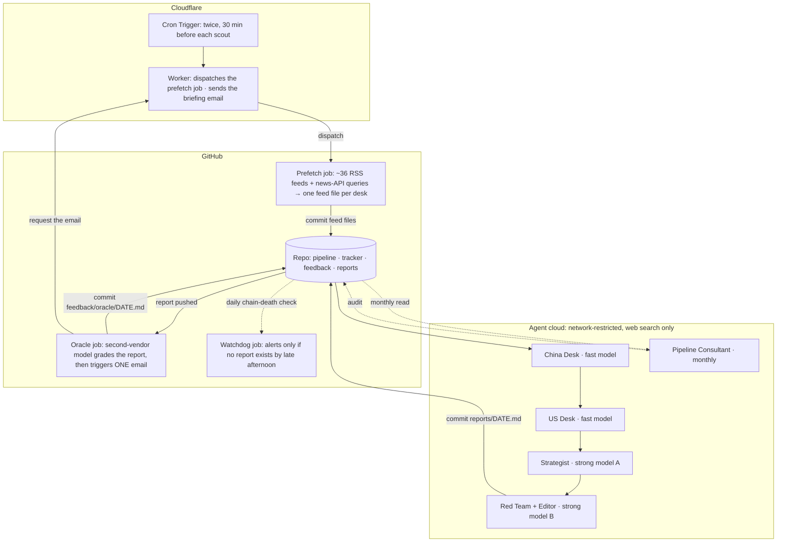

# Architecture

How the pipeline is built: the daily chain, the data flow, the quality harness and the monitors. [README.md](README.md) is the overview; [HARNESS-ENGINEERING.md](HARNESS-ENGINEERING.md) is the reasoning behind it. The reports this pipeline produces are not investment advice.

## Diagram

**The network boundary is the key constraint.** The cloud agents can search the web but not make arbitrary HTTP calls, so a GitHub Actions job on an unrestricted machine does all feed fetching and the Worker does all email and dispatch. Agents only ever read and write the repository. That design also wins on token cost, cross-day deduplication and on-time scheduling.

**The scheduler lives on Cloudflare, not GitHub.** GitHub's scheduled cron is best-effort and ran hours late; a Cloudflare Cron Trigger fires on time and dispatches the job, which starts within seconds. Parsing stays in the GitHub job because the free Worker plan's CPU cap is too small to parse dozens of feeds.

## The daily chain

| # | Agent | Model | When | Reads | Writes |
|---|-------|-------|-----------|-------|--------|
| 0 | Prefetch (no LLM) | — | ~30 min before each desk | RSS feeds, news API | `pipeline/DATE/feeds/{china,us}-feeds.md` |
| 1 | China Desk | Claude Sonnet 5.5 | early UTC morning | its feed file, scout instructions, China company trackers | `pipeline/DATE/china/01-raw.md` |
| 2 | US Desk | Claude Sonnet 5.5 | about an hour later | its feed file, the China Desk output, US company trackers | `pipeline/DATE/us/01-raw.md` |
| 3 | Strategist | Claude Fable 5.1 | after both desks | both raw files, trackers, the prediction ledger, the last 3 reports, `reference/landscape.md` | `03-strategic.md`, tracker updates, ledger scoring |
| 4 | Red Team + Editor | Claude Opus 5.5 | a few hours later | everything above, the quality log, the latest oracle and lint output | `reports/DATE.md`, `04-redteam.md`, scout instructions, quality log |
| — | Oracle | Gemini Flash (with a fallback ladder of Gemini models) | on report push | the report, the strategy notes, the ledger | `feedback/oracle/DATE.md` |
| — | Pipeline Consultant | Claude Fable 5.1 | monthly | recent reports, trackers, logs, scorecards | `audit/consultant/`, `reference/landscape.md` |

Order is load-bearing: each leg reads the previous leg's committed output, and two agents must never push at the same time. The agents are thin bootstraps that read `prompts/0N-*.md` from the repository at run time, so editing a prompt changes the very next run, with no staging.

The Strategist and the Red Team deliberately run **different models**, so the producer and its auditor do not share blind spots; the oracle adds a different **vendor** on top.

## Data flow

1. **Prefetch.** The Cron Trigger dispatches the prefetch job about 30 minutes before each scout. It fetches the feeds, splits them into one file per desk (its own region's feeds, shared wire and think-tank feeds, and entity-matched items routed from the other side), tags items already seen on a previous day, and commits.
2. **Scouts.** Each desk clones the repo, reads its feed file as local data, and fills gaps with web search (government sites, company blogs, breaking news). They tag every item and discard nothing.
3. **Strategist.** Reads both desks, cross-references US and China signals, decides what to kill (with reasons, into a discard pile), updates thread and company trackers, and scores yesterday's predictions against what actually happened.
4. **Red Team + Editor.** Audits the analysis and the discard pile, enforces the provenance gate, verifies every headline number, writes the final report, and writes instructions for tomorrow's scouts.
5. **Oracle + email.** The report push triggers the oracle job: a second-vendor model grades the report, re-scores the predictions independently, runs a rebuttal pass on its own harshest verdicts, and commits its verdict. Its final step asks the Worker to send one email that merges the report with the oracle's verdict. If the oracle fails, the briefing still goes out.
6. **Cleanup.** Feed files are deleted after 3 days, per-day pipeline folders after 14; reports are kept.
7. **Monthly review.** The Pipeline Consultant reviews the harness and keeps the structural-facts reference current.

## Quality harness

- **Provenance gate.** Every claim is tagged primary `[P]`, secondary `[S]`, analyst `[A]` or management `[M]`. Single-source, analyst-estimate, or management-in-incentive-window claims can never be top-tier Signal until a second source confirms them. Every headline number is verified or caveated, with an internal-consistency check.
- **Structural facts.** `reference/landscape.md` holds standing facts (entity map, binding constraints) the Strategist must not contradict without new evidence.
- **Prediction ledger.** Each report ends with dated, falsifiable calls. The Strategist scores them as HIT / MISS / PARTIAL / PENDING, with an obvious / non-obvious tag so a wall of safe calls cannot game it; the oracle re-scores independently.
- **Cross-day deduplication.** The prefetch job tags items that appeared on an earlier day, so agents do not re-report an unchanged story. Knowledge lives in the trackers; deduplication only stops re-printing.
- **Cross-vendor oracle.** The one check that does not share the Claude models' training.
- **All of these are monitors, never optimisation targets.**

## Deterministic monitors (no LLM, no agent tokens)

- **Watchdog** (scheduled, late afternoon UTC): if the desks produced output but no report exists, the chain died somewhere and nothing else will notice, so it sends an alert. Silent on success and on pause days.
- **Ref guard** (on a force-push to `main`): restores the previous tip if the branch was rewound, using a fast-forward-only update that can never move it backwards; alerts if history truly diverged.
- **Ops check** (with the oracle): every artifact present, both scouts found their feeds, web-search use within budget; the result is prepended to the email.
- **Numeric lint** (on report push): flags quantified superlatives with no provenance tag.
- **Tracker consistency** (on report push): flags thread files whose body contradicts their status header.
- **The loop:** the next Red Team reads the latest oracle, numeric-lint and tracker-lint output before it starts, and the Strategist reconciles tracker flags. A catch from one run feeds the next. None of these monitors edits a report or a tracker.

## Stack

| Component | Technology |
|-----------|-----------|
| Scheduler | Cloudflare Worker Cron Trigger → GitHub `workflow_dispatch` |
| Prefetch | GitHub Actions, Node.js, an RSS parser, a news API |
| Agents | Claude Code cloud routines |
| Oracle | GitHub Actions → Gemini API, in its own project so it has its own quota |
| Monitors | GitHub Actions, Node.js, no LLM |
| Email | the Worker merges report + oracle verdict → a transactional email API |
