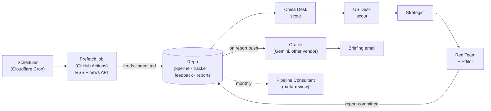

# US–China AI Briefing: a multi-agent architecture

A multi-agent system that writes a daily intelligence briefing on US–China AI, semiconductors and hyperscaler infrastructure. Two scout agents collect, a strategist analyses, a red team attacks the analysis and edits the final report, a model from a different vendor grades the result, and a set of zero-LLM monitors watch the whole chain. It runs unattended every day on Claude Code cloud routines, GitHub Actions and a Cloudflare Worker; a human reads the finished briefing.

> **Not investment advice.** The briefings include dated, falsifiable calls so the pipeline can grade its own calibration; none of it is a recommendation to buy, sell or hold anything.

**What this repository is:** the architecture and the agent prompts: the skeleton of how the pipeline is built and why. **What it is not:** a turnkey install. The live data (feeds, reports, trackers, prediction ledgers), the email Worker, deployment configuration, credentials and internal operating logs are not included.

## How a day runs



Each agent is a fresh instance that reads its prompt from `prompts/` at run time and hands off to the next one only through files committed to the repo. Details: [ARCHITECTURE.md](ARCHITECTURE.md).

## The agents

| Agent | Model tier | Job |
|-------|-----------|-----|
| China Desk / US Desk | fast (Sonnet) | Scan the pre-fetched feeds plus web search; tag every item Signal / Uncertain / Likely noise; never discard anything |
| Strategist | strongest available, different from the Red Team's | Cross-reference both desks, make the kill decisions with logged reasons, update the thread and company trackers, score yesterday's predictions |
| Red Team + Editor | strongest available | Attack the analysis, enforce the source-provenance gate, verify every headline number, audit the discard pile, write the final report and tomorrow's instructions for the scouts |
| Oracle | a different vendor (Gemini) | Independently grade the published report and re-score the predictions; monitor only, never edits |
| Pipeline Consultant | strong, monthly | Review the harness itself: quality trends, calibration, cost, stale reference facts |

## Why it is built this way

The design follows one idea: **reliable systems are built around unreliable models, not by waiting for reliable ones.** Concretely:

- **Filter late, not early.** Scouts tag but never discard; the strategist kills with a logged reason; the red team audits the discard pile.
- **Separate the generator from the evaluator.** A model grading its own work passes it. The red team is a separate agent with fresh context, and the oracle is a different vendor's model.
- **Prefer ground truth to opinion.** Web-search verification, a prediction ledger that reality grades, and deterministic lints catch more than a second opinion from the same model.
- **Monitors, never targets.** No prompt is ever told to improve a score, or it learns to game the score.
- **Every harness component is designed to be deleted** once a better model makes it unnecessary.

The full reasoning, with the evidence from running it: [HARNESS-ENGINEERING.md](HARNESS-ENGINEERING.md).

## Repository layout

```
prompts/          the agent prompts (01 China Desk, 02 US Desk, 03 Strategist, 04 Red Team, 05 Consultant, 06 Oracle)
pipeline/         per-day working files: feeds, raw scout output, strategy notes, usage logs (not included)
tracker/          persistent memory across days: running threads and per-company files (not included)
feedback/         loops back into the agents: scout instructions, prediction ledger, oracle and lint output (not included)
reference/        standing structural facts the strategist must not contradict (not included)
reports/          the published daily briefings (not included)
scripts/          deterministic monitors and the prefetch job (described, not included)
worker/           the scheduler + email sender (described, not included)
.github/workflows the prefetch, oracle, lint and watchdog jobs (described, not included)
```

Each folder has a README describing what lives there and who reads or writes it. Start with [`prompts/README.md`](prompts/README.md): it explains the terms and the internal files the prompts mention, which are not part of this edition.

## Adapting it

To run something like this you need: a repository the agents can clone and push to; scheduled agent runs with repository access (this pipeline uses Claude Code cloud routines); a job that fetches feeds outside the agents' network sandbox (GitHub Actions here); optionally a second vendor's API key for the oracle; and an email sender. Keep every credential in your platform's secret store; none belongs in the prompts or the repository. `.env.example` lists the names this design expects.

## Disclaimer

The briefings this pipeline produces include dated, falsifiable predictions ("Watch List" calls), some about listed companies. They exist so the pipeline can grade its own calibration against reality. **They are not investment advice.** This repository contains no reports and no third-party article text; if you run your own version, fetch only what each source's terms allow.

## Credits and license

Built by [williamchen419-eng](https://github.com/williamchen419-eng). Released under the [MIT License](LICENSE).
